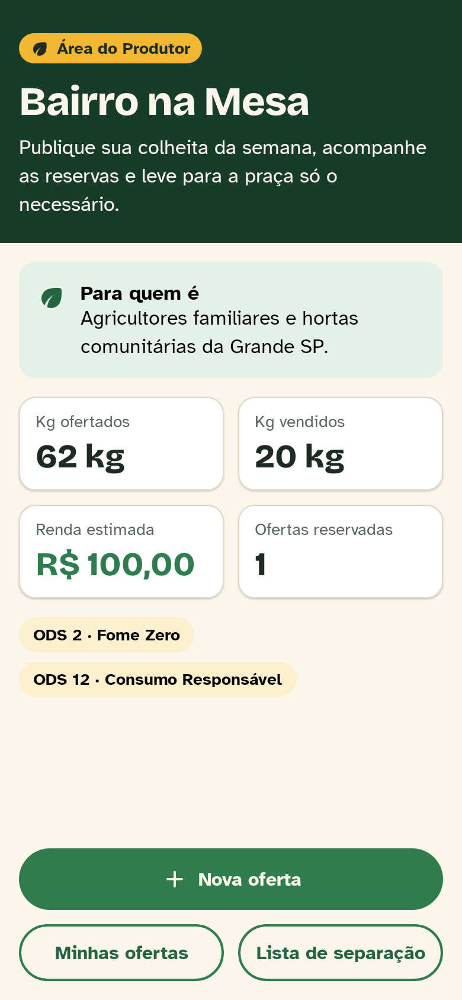
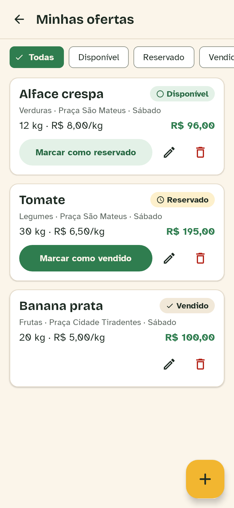
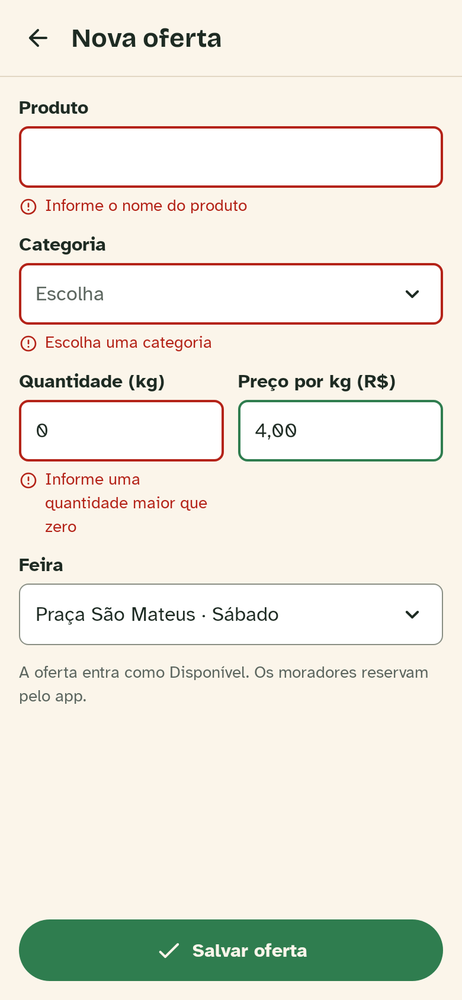
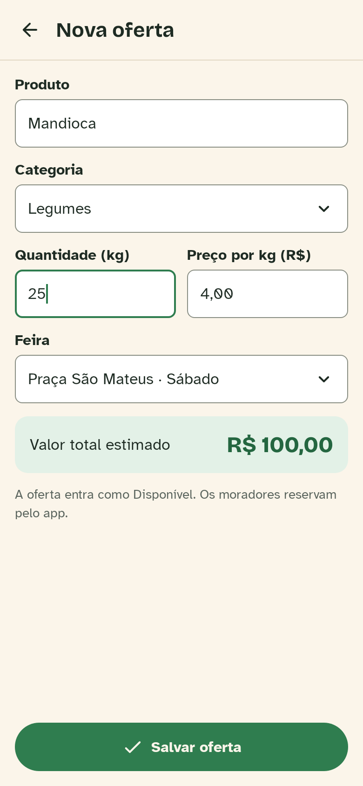
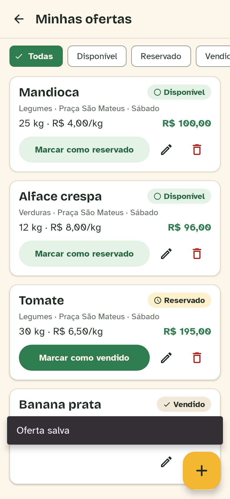
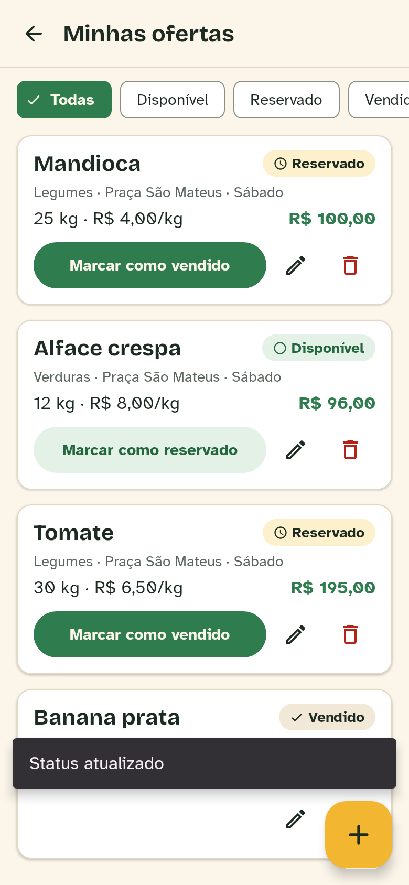
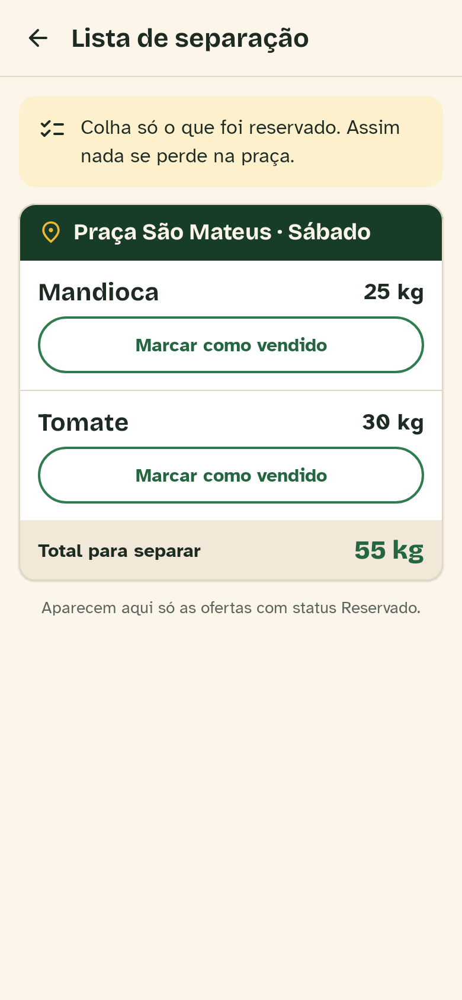
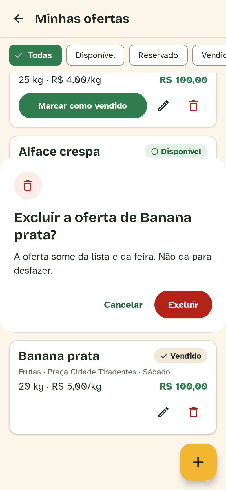
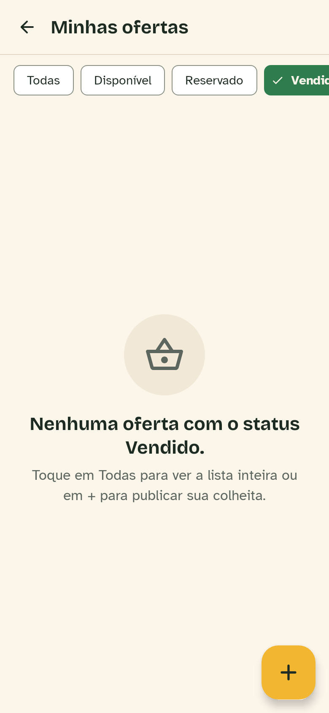

# Bairro na Mesa – App do Produtor


App Android (Kotlin + Jetpack Compose) da disciplina *Android Kotlin Developer* (GS 2026.2 – CitizenTech).

> **Protótipo acadêmico.** Os dados ficam só no aparelho (Room). O app **não** está integrado à API do Bairro na Mesa, ao app Flutter do morador, à prefeitura, ao CRAS nem a nenhum serviço público.

## Integrantes

| Nome completo | RM |
|---|---|
| João Victor Oliveira Avellar| 550283 |


## Problema e público beneficiado

O pequeno produtor da Grande SP vende sem previsibilidade, depende de atravessadores e perde parte da colheita. A persona é o **Seu José**, agricultor familiar de Mogi das Cruzes. O app atende agricultores familiares e hortas comunitárias e, de forma indireta, as famílias que compram nas praças.

## Proposta da solução

O **Bairro na Mesa** transforma praças da periferia em pontos semanais de comida acessível. O app Flutter (já desenvolvido) atende o **morador**: catálogo, cesta, pré-pedido e QR code. Este app Android cobre **o outro lado da feira, o produtor**:

1. publicar a oferta da semana (produto, quantidade, preço e praça);
2. acompanhar o que foi reservado e vendido;
3. receber a **lista de separação** e colher só o necessário.

Nos dois apps os nomes das feiras e das categorias são os mesmos. Neste protótipo, as reservas são simuladas pelo próprio produtor com o botão "Marcar como reservado".

## ODS

| ODS | Meta | Como o app contribui |
|---|---|---|
| **ODS 2 – Fome Zero** | 2.3 – dobrar a renda dos pequenos produtores | Venda direta na praça, sem atravessador. A tela inicial mostra a renda estimada |
| **ODS 12 – Consumo e Produção Responsáveis** | 12.3 – reduzir o desperdício de alimentos | A lista de separação mostra só o que foi reservado, então o produtor colhe só isso |

## Funcionalidades

| # | Funcionalidade |
|---|---|
| F1 | Tela inicial com indicadores de impacto: kg ofertados, kg vendidos, renda estimada e ofertas reservadas |
| F2 | Cadastro de oferta com validação e prévia do valor total |
| F3 | Lista de ofertas com filtro por status (Todas, Disponível, Reservado, Vendido) |
| F4 | Avançar status: Disponível → Reservado → Vendido |
| F5 | Edição e exclusão com confirmação |
| F6 | Lista de separação: reservas agrupadas por feira, com o total em kg |

## Tecnologias

| Item | Versão |
|---|---|
| compileSdk / targetSdk | 35 |
| minSdk | 26 (Android 8.0) |
| JDK | 17 (o que vem com o Android Studio) |
| Android Gradle Plugin | 8.7.3 (Gradle 8.9) |
| Kotlin | 2.0.21 + plugin Compose |
| KSP | 2.0.21-1.0.28 |
| Compose BOM | 2024.12.01 (Material 3) |
| Navigation Compose | 2.8.5 |
| Lifecycle (ViewModel / runtime-compose) | 2.8.7 |
| Room | 2.6.1 |

**Atenção:** não aceite o "Upgrade Assistant" do Android Studio. Atualizar versões quebra o build.

## Arquitetura

O projeto usa MVVM simples, com a injeção de dependência feita à mão (`ViewModelProvider.Factory`).

```
UI (Compose)  →  OfertaViewModel  →  OfertaRepository  →  OfertaDao  →  Room (SQLite)
   ↑  StateFlow  ←  Flow  ←──────────────────────────────────────────────┘
```

O DAO devolve `Flow`, que o ViewModel transforma em `StateFlow` e a tela lê com `collectAsStateWithLifecycle`. Assim a tela se atualiza sozinha quando o banco muda. As mensagens de Snackbar passam por um `Channel`, porque são eventos de uma vez só e não podem reaparecer quando a tela gira.

```
app/src/main/java/br/com/fiap/bairronamesa/
├── BairroNaMesaApp.kt        # Application: cria banco e repositório
├── MainActivity.kt
├── data/                     # Oferta (@Entity), OfertaDao, AppDatabase (+ seed), OfertaRepository, DadosMock
├── viewmodel/                # OfertaViewModel (ResumoImpacto, FormOfertaState) + Factory
├── navigation/               # Rotas, AppNavHost
└── ui/
    ├── theme/                # Color, Type, Theme
    ├── components/           # OfertaCard, StatusChip, ResumoCard, EstadoVazio, Campos, FiltroChips, TopBarVoltar, Cartao, Formatos
    └── screens/              # Inicio, ListaOfertas, CadastroOferta, Separacao
```

## Como executar no Windows 11

1. Instale o **Android Studio Ladybug (2024.2) ou mais novo**.
2. Abra o projeto em **File > Open** e selecione a pasta do projeto, a que contém `settings.gradle.kts`.
3. Aguarde o **Gradle Sync** terminar. Na primeira vez ele baixa as dependências e pode levar alguns minutos.
4. Crie um emulador em **Device Manager > + > Pixel > API 35** (o mínimo é API 26).
5. Clique em **Run ▶**.

Para compilar pelo terminal (PowerShell ou CMD), dentro da pasta do projeto:

```bash
gradlew.bat assembleDebug
```

```bash
gradlew.bat testDebugUnitTest
```

O APK é gerado em `app\build\outputs\apk\debug\app-debug.apk`.

## Fluxo principal

Início → **Nova oferta** → preencher → **Salvar oferta** → lista com o Snackbar "Oferta salva" → **Marcar como reservado** → Início → **Lista de separação** → **Marcar como vendido**.

O banco já começa com 3 ofertas de exemplo (Alface crespa / Disponível, Tomate / Reservado, Banana prata / Vendido), para os indicadores e a lista de separação já aparecerem com conteúdo.

## Capturas de tela e evidências

Os prints ficam em `docs\prints\` (roteiro da seção 11 de `docs\PLANO.md`):

| Print | O que mostra |
|---|---|
| `01-inicio.png` | Tela inicial com os indicadores |
| `02-lista.png` | Lista com as 3 ofertas de exemplo |
| `03-validacao.png` | Mensagens de erro ao salvar com produto vazio e kg = 0 |
| `04-cadastro.png` | Formulário preenchido (Mandioca, Legumes, 25 kg, R$ 4,00) |
| `05-criada.png` | **Criação:** nova oferta na lista + Snackbar "Oferta salva" |
| `06-status.png` | **Ação adicional:** Mandioca marcada como Reservado |
| `07-separacao.png` | Lista de separação com a Mandioca |
| `08-excluir.png` | Diálogo de confirmação de exclusão |
| `09-reaberto.png` | **Persistência:** app fechado pelo multitarefa e reaberto, Mandioca ainda Reservada |
| `10-vazio.png` | Filtro sem resultado mostrando o estado vazio |

O app é fechado pelo **multitarefa** (arrastar para cima), e não só pelo "voltar", porque isso encerra o processo. Assim o print prova que o dado veio do Room, e não da memória.

> Os prints de `01` a `10` foram gerados executando o app (MainActivity, Room e ViewModel reais) no **Robolectric**, um Android simulado na JVM, numa tela de 390 × 844 dp. Por isso não aparece a barra de status, e o diálogo de exclusão sai sem o fundo escurecido. O print `09-reaberto.png` (persistência) precisa ser feito no emulador, porque exige fechar o app pelo multitarefa.

| Início | Lista | Validação |
|---|---|---|
|  |  |  |
| **Cadastro** | **Oferta criada** | **Status atualizado** |
|  |  |  |
| **Lista de separação** | **Excluir** | **Filtro vazio** |
|  |  |  |


## Roadmap

- Integração com a API Spring do Bairro na Mesa (reservas reais vindas do app do morador).
- Login do produtor.
- Notificação de nova reserva.
